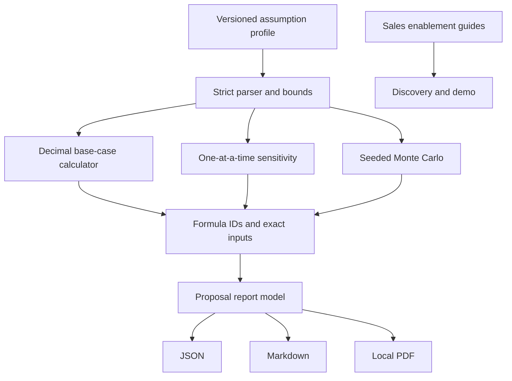

# Architecture

## Components

## Boundaries

- `assumptions.py` validates input shape, version, currency, fictional label, and numeric bounds.
- `calculator.py` owns exact base-case formulas and one-input-at-a-time sensitivity.
- `simulation.py` owns bounded seeded sampling and percentile calculations.
- `reporting.py` serializes provenance and renders local JSON, Markdown, and PDF.
- `cli.py` coordinates validated input and outputs without network or database access.

The core has no API or persistent service; therefore OpenAPI and database migration documentation
do not apply.

## Failure behavior

Invalid profiles, unreasonable run counts, malformed JSON, and filesystem failures return explicit
CLI errors. Inputs are validated before formulas or exports run. Monte Carlo is limited to 100,000
iterations per invocation.
