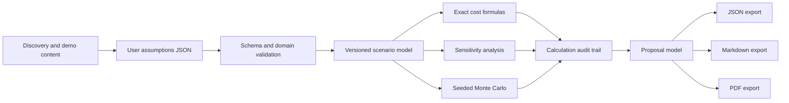

# Design — SolutionFit Sales Engineering

## Purpose and product boundary

SolutionFit is a local sales-engineering toolkit for modeling the economics of a fictional QA
automation product named **QualityPath**. No TestLens source project was present in the workspace,
so QualityPath is explicitly fictional. The included scenario is an illustrative assumption set,
not a customer, quote, market benchmark, or claim about realized savings.

The tool helps a seller structure discovery, expose assumptions, compare manual-regression costs
with a modeled automation scenario, and produce a proposal from user-entered inputs.

## Requirements

### Functional

1. Validate a versioned JSON assumption profile with currency, a named illustrative scenario,
   baseline workload, cost inputs, automation coverage, and low/base/high ranges.
2. Compare baseline and modeled annual and multi-year costs with explicit formulas and currency
   rounding.
3. Generate one-at-a-time sensitivity results and reproducible Monte Carlo estimates over declared
   input ranges.
4. Preserve an audit record for each output, including formula identifier, exact inputs, and result.
5. Generate a proposal as JSON, Markdown, and PDF without inventing a customer, outcome, or product
   capability.
6. Include a discovery-question guide, five-minute demo script, objection-handling guide, and
   one-page solution brief.
7. Test numeric correctness, validation boundaries, simulation reproducibility, and malformed input.

### Non-functional

- Python 3.12 with strict typing, Ruff, and at least 85% coverage.
- Deterministic calculations use `Decimal`; simulation uses a recorded pseudo-random seed and
  reports estimates separately from exact arithmetic.
- Inputs are finite and bounded; no network access, external service, or customer data is required.
- Every estimate remains visibly conditional on the supplied assumptions.

## Non-goals

- QualityPath is not a real product. The toolkit does not assert that it exists or has particular
  capabilities beyond the explicitly fictional scenario.
- No customers, quotes, market prices, savings, adoption rates, or measured sales outcomes are
  represented as real.
- No CRM, billing, procurement, contract, or payment integration.
- No financial, accounting, legal, or procurement advice.
- No automatic discovery of product or customer facts.

## Architecture

### Data model

- `ScenarioAssumptions`: schema and assumption-set versions, scenario label, currency, baseline
  regression effort, labor rate, assumed automation coverage, license/support costs, implementation
  costs, and low/base/high input ranges.
- `CalculationEntry`: stable metric identifier, formula identifier, exact input values, and output
  value.
- `ScenarioResult`: baseline costs, modeled costs, savings, ROI, payback, time horizon, sensitivity
  results, and reproducible simulation metadata.
- `Proposal`: fictional product description, user-provided scenario label, modeled results, caveats,
  and calculation audit trail.

## Calculation definitions

- Annual baseline cost = releases per year × manual regression hours per release × loaded hourly
  rate.
- Annual modeled cost = residual manual regression cost + annual license cost + annual support
  cost.
- Residual manual hours = manual regression hours × (1 − assumed automation coverage).
- Year-one modeled cost adds one-time implementation cost to annual modeled cost.
- Annual net savings = annual baseline cost − annual modeled cost.
- Year-one ROI = (annual net savings − one-time implementation cost) ÷ one-time implementation
  cost. A zero implementation cost is invalid so ROI is defined.
- Payback is reported only when annual net savings are positive; otherwise the result explicitly
  reports no payback under the supplied assumptions.

These are transparent scenario formulas, not predictions. The model assumes annual workload and
cost inputs remain constant over the selected horizon; this is surfaced as a limitation.

## Sensitivity and simulation

Sensitivity varies one declared input at a time across low/base/high while holding all other inputs
at base values. Monte Carlo uses independent triangular distributions defined by each input's
low/base/high values. The user-selected seed, run count, distribution, and summary percentiles are
stored in the output. Independence is a simplifying assumption, not a claim about real-world
correlation. Monte Carlo outputs are estimates and never replace the exact base-case calculation.

## Alternatives considered

- **Treating a fictional product as an existing product**: rejected because the TestLens project was
  unavailable; the sample must not imply real capabilities or customers.
- **Hidden default assumptions**: rejected because unshown values could make a proposal misleading;
  assumptions are versioned, visible, and copied into the audit output.
- **Opaque spreadsheet-only formulas**: rejected because formula identifiers and exact inputs must
  be reviewable and tested.
- **External PDF conversion service**: rejected to avoid transmitting assumptions or proposals;
  PDF creation is local.
- **Correlated Monte Carlo model**: deferred because no user-supplied data supports a defensible
  correlation structure.

## Threat model

| Threat | Mitigation | Residual risk |
|---|---|---|
| Invalid or extreme numeric input distorts a proposal | Strict schema, finite bounds, domain checks, and numeric tests | Valid but unrealistic assumptions still produce misleading scenarios |
| Output implies guaranteed savings or a real customer | Explicit fictional labels, formula audit, and caveats in each export | A user may remove caveats after export |
| Malformed JSON or PDF text causes a crash | Validate input before calculations and escape rendered text | ReportLab/browser-independent font limitations |
| Unreproducible simulation | Store seed, run count, distribution, and versioned assumptions | Estimates vary when the seed or ranges change |
| Sensitive business assumptions leak | Local-only operation, no telemetry, no network requests | User-controlled output files may be shared externally |

## Operational behavior

- Run calculation and export locally from a supplied JSON assumption profile.
- Invalid assumptions fail explicitly before proposal generation.
- No database migrations or service shutdown are required.
- To roll back, restore the previous versioned assumption file and rerun the documented command.
- Monte Carlo is bounded by an explicit maximum run count and a recorded random seed.
